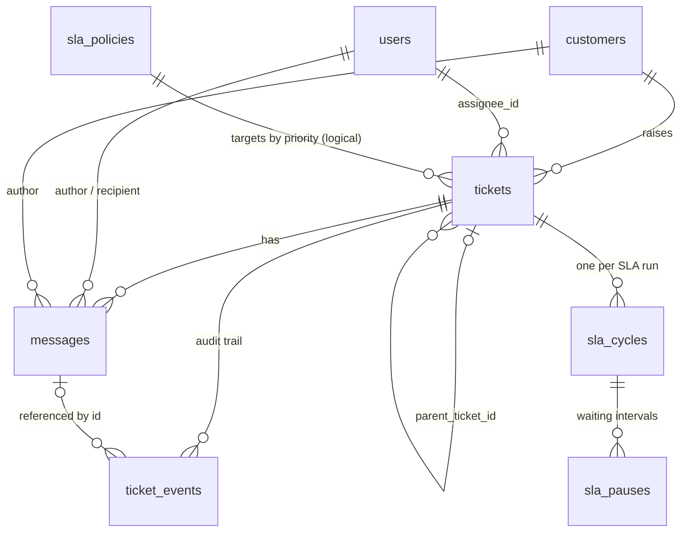

# Frontdesk: Database Implementation

Database design for Frontdesk (Arvo Systems support system). Target: **PostgreSQL 14+**, managed with **Drizzle ORM** (`drizzle-orm` + `drizzle-kit`, plain JavaScript, `pg` driver). Drizzle owns the tables, enums, constraints and indexes. A small hand-written SQL migration owns the things Drizzle can't express (triggers, the hash chain, views, seed data).

> Every design choice below traces back to something in the brief: a line from Meera's meeting notes (§3 of the hiring test PDF) or one of the three incident reports (§4 of the PDF). Those references are tagged **[M]** (meeting) and **[INC-xxxx]** (incident).

---

## 1. Design principles

| # | Principle | Why |
|---|---|---|
| 1 | **Messages are rows, never a JSON blob on the ticket.** | Concurrent replies can't overwrite each other, and notes and public replies stay in separate, filterable rows **[INC-0304]**. At ~40 tickets/day, one indexed lookup on `(ticket_id, created_at)` is effectively free. |
| 2 | **History is append-only and enforced by the database**, not by app discipline. | **[INC-0318]** "Nobody should be able to change that record later." Triggers reject `UPDATE`/`DELETE`/`TRUNCATE` on `messages` and `ticket_events`. |
| 3 | **The server sets every timestamp.** Stored as `timestamptz` (UTC). Clients never send time. | **[INC-0318]** Proof of "when". JSON output is ISO 8601 with `Z`. Display converts to Asia/Kolkata. |
| 4 | **Events reference messages by ID and never copy the body.** | A note's text must exist in exactly one place, where we can control access **[INC-0304]**. |
| 5 | **The customer side reads only through views** that cannot contain notes. | Privacy by construction, plus an optional DB role that can read nothing else. |
| 6 | **State changes are atomic SQL**, e.g. `UPDATE ... WHERE assignee_id IS NULL`. | **[INC-0291]** The database arbitrates the double-claim race. |
| 7 | **Due dates are persisted, and the inputs to them are too.** | The tick job gets a simple indexed query, and every due date can be recomputed and audited. |
| 8 | **Nothing is ever deleted.** Users are deactivated, and tickets are closed. | History must be complete. |

---

## 2. Entity overview



| Table | Mutable? | Purpose |
|---|---|---|
| `users` | yes | Agents and the lead. Deactivate instead of delete. |
| `customers` | yes | People who raise tickets. Unique by lower-cased email. |
| `tickets` | yes (current state only) | One row per ticket. This is the *current* snapshot. History lives in events. |
| `messages` | **append-only** | Every public reply and every team note. |
| `ticket_events` | **append-only, hash-chained** | The audit log: claims, replies, status and priority changes, pauses, breaches. |
| `sla_cycles` | yes | One per SLA run (initial, plus one per reopen). Holds budgets and persisted due dates. |
| `sla_pauses` | yes (closed once) | Waiting-on-customer intervals. |
| `sla_policies` | yes (config) | Reply/resolve targets per priority, editable. |
| `holidays` | yes (config) | Non-working days. Seeded and editable. |
| `settings` | yes (config) | Working hours, timezone, window lengths. |

Views: `customer_tickets`, `customer_messages` (customer-safe) and `agent_ticket_list` (agent list with late/waiting flags).

---

## 3. Plain-English guide: the SLA tables, the audit log, settings and the access token

### 3.1 The SLA tables: how "late" gets decided

An **SLA** is the promise Arvo makes: *reply within X, fix within Y*. Four small tables hold it.

| Table | Think of it as | One row means |
|---|---|---|
| `sla_policies` | **The rulebook** | "A *high* ticket needs a reply in 120 business minutes and a fix the same working day." There are only 3 rows (high / medium / low). |
| `sla_cycles` | **The scoreboard for one ticket** | "This ticket's timer started at X. Reply is due by A, fix is due by B. Reply actually happened at C." |
| `sla_pauses` | **The stopwatch pauses** | "The clock was stopped from P to Q because we were waiting for the customer." |
| `holidays` | **The calendar** | A day nobody works. The time engine skips these days. |

**Why not just put `due_at` on the ticket?** Three reasons, each from the brief:

1. **Reopens.** When a customer reopens a ticket **[M]**, a fresh timer starts, but the first run's result must stay on record. One cycle row per run gives each run its own scoreboard. Cycle 1 is the original, and cycle 2 is the reopen.
2. **Pauses.** Waiting time must not count against Arvo **[M]**. Each pause is its own row, so the total can be added up and audited later (INC-0318).
3. **Rules change.** If someone edits `sla_policies` next month, old tickets must not retroactively become late. So the cycle **copies the budgets in** (`reply_budget_minutes`, `resolve_budget_minutes`) and stores the computed deadlines (`reply_due_at`, `resolve_due_at`). The policy table is only read when a cycle starts or the priority changes.

**Worked example.** A *medium* ticket arrives **Friday 5:00 PM** (budgets: reply 270 min, fix 1620 min = 3 working days of 540).

| What happens | What the tables say |
|---|---|
| Ticket arrives Fri 17:00 | `sla_cycles` row created: `clock_start_at` = Fri 17:00. **Reply due** = Mon 12:30 (90 min left on Friday, then 180 min on Monday from 9:30). **Fix due** = Wed 17:00. |
| Saturday and Sunday pass | Nothing happens. Both due dates are on Monday or later, so nothing is late. |
| Agent replies Fri 17:20 and asks a question | `first_response_at` = Fri 17:20, so the reply SLA is **met**. The ticket becomes `waiting_on_customer`, and a row opens in `sla_pauses` (`paused_at` = Fri 17:20). |
| Customer answers the next Wed 10:00 | The pause row closes. `business_minutes` = 70 + 540 + 540 + 30 = **1180**. `resolve_due_at` is recomputed as clock start + (1620 + 1180) business minutes, so the fix deadline moved back by exactly the time we were waiting. |
| A manager asks "was this late?" | Compare `first_response_at` with `reply_due_at`, and `resolved_at` with `resolve_due_at`. Every input is stored, so it can be recomputed and proven. |

**Breach columns.** `reply_breached_at` and `resolve_breached_at` are written **once** by the per-minute job the first time it notices a deadline passed. They exist so a breach event is logged exactly once. They are the *detection* time, not the deadline. The "is it late right now" flag in the agent list is computed from the due dates at read time, so it never depends on that job.

**If 8 hours gets tight:** `sla_policies` and `settings` could become a `config.js` constants file. The `sla_cycles` snapshot columns still work unchanged. Keeping them in tables only buys you "a lead can edit it without a deploy".

### 3.2 `ticket_events`: the flight recorder

`tickets` only shows **how a ticket looks right now**. That's exactly the spreadsheet's flaw: it "keeps no history" and nobody could prove the INC-0318 timeline. `ticket_events` is the fix: **one row per thing that happened**, never edited, never deleted.

```
ticket FD-0042
 #1  05:11:02Z  ticket_created      customer: Priya
 #2  05:13:10Z  claimed             staff: Anil
 #3  05:14:55Z  note_added          staff: Anil        (message_id 7, no text here)
 #4  05:21:30Z  public_reply_sent   staff: Anil        (message_id 8)
 #5  05:21:30Z  sla_paused          staff: Anil
 #6  08:32:11Z  customer_replied    customer: Priya
 #7  08:32:11Z  sla_resumed         customer: Priya    {business_minutes: 190}
```

For INC-0318 the answer is now one query: *"reply sent at #4, 10 minutes after arrival."* (Times are UTC. 05:11Z is 10:41 AM in Kochi.)

- **Who / when / what**: `actor_*` columns, `created_at` (set by the database, never the client), `type` and `payload`.
- **`message_id` instead of the text**: the event points at the message and never copies it. A private note's words live in exactly one table, so they can't leak through the log (INC-0304).
- **Append-only**: database triggers refuse `UPDATE`, `DELETE` and `TRUNCATE`. The app can't edit history even by accident.
- **Hash chain (`prev_hash`, `hash`)**: each row stores a fingerprint of itself plus the previous row's fingerprint. If anyone secretly alters an old event, its fingerprint stops matching, and `verify_ticket_chain(ticket_id)` shows exactly where. It's tamper-**evidence**, to cover the case where someone with database admin access bypasses the triggers.
- **`chain_seq`**: 1, 2, 3 per ticket, assigned by the trigger so the order is trustworthy even under simultaneous writes.

### 3.3 `settings` and `holidays`

`settings` is a list of named values (`key` → `value`) the business-time engine reads instead of hard-coding them:

| key | value | Used for |
|---|---|---|
| `timezone` | `Asia/Kolkata` | All "9:30 to 6:30" maths. Stored times stay UTC. |
| `work_start` / `work_end` | `09:30` / `18:30` | A working day is 540 minutes. |
| `work_days` | `1,2,3,4,5` | Monday to Friday. |
| `auto_close_business_minutes` | `2700` | "About one working week" waiting on a customer = 5 × 540. |
| `reopen_business_minutes` | `2700` | "About one week" to reopen after resolve. |

Meera said "about" a lot, so these values are likely to be tuned. A config row is easier to change than code. `holidays` is the same idea for festival days.

### 3.4 `access_token_hash`: how customers open their ticket without a login

Customers don't have accounts. Instead, when a ticket is created the server generates a long random **token** (e.g. 32 random bytes shown as hex) and gives the customer a link: `https://your-app/t/<token>`. Anyone holding the link can see **that one ticket** and nothing else.

The database stores **only a hash** of the token (`sha256(token)`), never the token:

1. Ticket created → server makes the token, stores `sha256(token)` in `access_token_hash`, and shows the link **once** to the customer. There is no email channel, so display it on the confirmation screen.
2. Customer opens `/t/<token>` → server computes `sha256(token)` and looks up the ticket by that hash.
3. If the database is ever leaked, the attacker gets hashes, which are useless for building working links. This is the same reason passwords are stored hashed.

A plain fast hash like SHA-256 is fine here, unlike for passwords, because the token is long and random (unguessable), not a human-chosen word. This is also why the customer views expose `access_token_hash`: the view is filtered by `WHERE access_token_hash = $1`, so a customer can only ever reach their own ticket's public messages.

---
## 4. Decisions the schema encodes

These are interpretations. Put the important ones in the README's decision log.

| Topic | Decision |
|---|---|
| Statuses | `new` → `open` ⇄ `waiting_on_customer` → `resolved` → `closed`. `resolved` is "agent marked done" and is reopenable. `closed` is final. |
| Unclaimed | `assignee_id IS NULL AND status IN ('new','open')`. A released ticket keeps its status and loses its assignee. |
| Waiting | Entered only by a **public reply** (we asked a question). A note can never pause the clock. |
| Pause | An open row in `sla_pauses`. It closes when the customer replies. Pauses only affect the **resolve** clock, because the first reply already happened before a ticket can wait. |
| Auto-close **[M]** | `auto_close_at` is persisted when waiting starts: 5 working days (2700 business minutes) later. The tick job closes the ticket with `closed_reason='customer_no_reply'`. |
| Reopen window **[M]** | `reopen_until` is persisted at resolve time (5 working days). While it is open, reopen is allowed. After that the customer's message creates a **new ticket** with `parent_ticket_id` set. |
| Reopen SLA | A reopen creates a new `sla_cycles` row (`is_reopen = true`). Old cycles stay. The assignee is kept. |
| Same-day resolve (High) | The resolve budget is the business minutes from `clock_start_at` to the close of that working day, computed by the app and **stored as a number** in the cycle. |
| Priority change **[M]** | The cycle keeps its original `clock_start_at`. The new budgets are recomputed from that start and due dates are recalculated. Escalating can make a ticket instantly late, and downgrading never erases a recorded breach. Every change is an event. |
| Recorded breaches | `*_breached_at` is the **detection** time. Whether the SLA was met is always derivable from `first_response_at`/`resolved_at` vs the `*_due_at` columns. |
| Read receipts | Out of scope (no customer channel). `recipient_user_id` is stored on customer messages, so "who was it addressed to" is provable. |

---

## 5. Drizzle setup

### 5.1 What Drizzle manages and what stays as raw SQL

| Drizzle (`db/schema.js`, auto-generated migration) | Hand-written SQL (custom migration, run by the same Drizzle migrator) |
|---|---|
| Tables, columns, enums, foreign keys | `set_updated_at` / `forbid_modification` functions |
| `CHECK` constraints, unique and **partial** indexes, expression indexes (`lower(email)`) | Append-only triggers on `messages`, `ticket_events`, `tickets` |
| Typed query builder for the app | Hash-chain function + trigger, `verify_ticket_chain()` |
| | Views (`customer_*`, `agent_ticket_list`), seed data |
| | Optional DB roles |

Views are declared in `schema.js` with `.existing()`. That gives you typed queries (`db.select().from(customerMessages)`) without Drizzle trying to create or drop them.

**Workflow rules**

- Use **`drizzle-kit generate` + `migrate`** only. Do **not** use `drizzle-kit push`. It knows nothing about the triggers and views and can fight them.
- Changing a table later means editing `schema.js`, running `npm run db:generate`, and committing the new `.sql` file. The custom SQL files are never regenerated.
- The two custom files are created with `drizzle-kit generate --custom --name=...`, so they sit in the same ordered journal as the generated one.

```bash
npm i drizzle-orm pg
npm i -D drizzle-kit
# package.json: { "type": "module", "scripts": {
#   "db:generate": "drizzle-kit generate",
#   "db:migrate":  "node migrate.js",
#   "test":        "node --test" } }   # plain `node --test`: a directory argument fails on Node 22
npm run db:generate -- --name=schema                 # tables from schema.js  -> 0000_schema.sql
npx drizzle-kit generate --custom --name=db_logic    # empty file you fill with 5.4  -> 0001
npx drizzle-kit generate --custom --name=roles_optional   # 5.5 -> 0002
DATABASE_URL=postgres://... npm run db:migrate
```

### 5.2 `drizzle.config.js` and `migrate.js`

```js
// drizzle.config.js
import { defineConfig } from 'drizzle-kit';
export default defineConfig({
  dialect: 'postgresql',
  schema: './db/schema.js',
  out: './db/migrations',
  dbCredentials: { url: process.env.DATABASE_URL },
});
```

```js
// migrate.js  (also run this on deploy, e.g. as the Render "pre-deploy command")
import { drizzle } from 'drizzle-orm/node-postgres';
import { migrate } from 'drizzle-orm/node-postgres/migrator';
import pg from 'pg';
const pool = new pg.Pool({ connectionString: process.env.DATABASE_URL });
await migrate(drizzle(pool), { migrationsFolder: './db/migrations' });
await pool.end();
```

### 5.3 `db/schema.js`

```js
import { sql } from 'drizzle-orm';
import {
  pgTable, pgEnum, pgView, bigint, integer, text, boolean, timestamp, jsonb,
  customType, index, uniqueIndex, unique, check, date,
} from 'drizzle-orm/pg-core';

// ---------- helpers ----------
const id = () => bigint('id', { mode: 'number' }).primaryKey().generatedAlwaysAsIdentity();
const fk = (name) => bigint(name, { mode: 'number' });
const tstz = (name) => timestamp(name, { withTimezone: true, mode: 'date' });
const bytea = customType({ dataType: () => 'bytea' });

// ---------- enums ----------
export const userRole = pgEnum('user_role', ['agent', 'lead']);
export const ticketPriority = pgEnum('ticket_priority', ['high', 'medium', 'low']);
export const ticketStatus = pgEnum('ticket_status', ['new', 'open', 'waiting_on_customer', 'resolved', 'closed']);
export const messageKind = pgEnum('message_kind', ['public', 'note']);
export const actorType = pgEnum('actor_type', ['staff', 'customer', 'system']);
export const closedReason = pgEnum('closed_reason', ['customer_no_reply', 'resolution_window_elapsed']);

// ---------- reference / config ----------
export const users = pgTable('users', {
  id: id(),
  name: text('name').notNull(),
  email: text('email').notNull(),
  passwordHash: text('password_hash').notNull(),
  role: userRole('role').notNull().default('agent'),
  active: boolean('active').notNull().default(true),
  createdAt: tstz('created_at').notNull().defaultNow(),
  updatedAt: tstz('updated_at').notNull().defaultNow(),
}, (t) => [
  uniqueIndex('users_email_uq').on(sql`lower(${t.email})`),
  check('users_name_chk', sql`length(btrim(${t.name})) > 0`),
]);

export const customers = pgTable('customers', {
  id: id(),
  name: text('name').notNull(),
  email: text('email').notNull(),
  createdAt: tstz('created_at').notNull().defaultNow(),
}, (t) => [
  uniqueIndex('customers_email_uq').on(sql`lower(${t.email})`),
  check('customers_name_chk', sql`length(btrim(${t.name})) > 0`),
]);

export const holidays = pgTable('holidays', {
  holidayDate: date('holiday_date', { mode: 'string' }).primaryKey(),
  name: text('name').notNull(),
  createdAt: tstz('created_at').notNull().defaultNow(),
});

export const settings = pgTable('settings', {
  key: text('key').primaryKey(),
  value: text('value').notNull(),
  description: text('description'),
});

export const slaPolicies = pgTable('sla_policies', {
  priority: ticketPriority('priority').primaryKey(),
  replyMinutes: integer('reply_minutes').notNull(),
  resolveMinutes: integer('resolve_minutes'),
  resolveSameDay: boolean('resolve_same_day').notNull().default(false),
}, (t) => [
  check('sla_policies_reply_chk', sql`${t.replyMinutes} > 0`),
  check('sla_policies_resolve_chk', sql`(${t.resolveSameDay} AND ${t.resolveMinutes} IS NULL) OR (NOT ${t.resolveSameDay} AND ${t.resolveMinutes} > 0)`),
]);

// ---------- tickets ----------
export const tickets = pgTable('tickets', {
  id: id(),
  ticketNo: integer('ticket_no').notNull().unique().generatedAlwaysAsIdentity(),
  customerId: fk('customer_id').notNull().references(() => customers.id),
  subject: text('subject').notNull(),
  priority: ticketPriority('priority').notNull().default('medium'),
  status: ticketStatus('status').notNull().default('new'),
  assigneeId: fk('assignee_id').references(() => users.id),
  claimedAt: tstz('claimed_at'),
  parentTicketId: fk('parent_ticket_id').references(() => tickets.id),
  accessTokenHash: bytea('access_token_hash').notNull().unique(),
  waitingSince: tstz('waiting_since'),
  autoCloseAt: tstz('auto_close_at'),
  resolvedAt: tstz('resolved_at'),
  reopenUntil: tstz('reopen_until'),
  closedAt: tstz('closed_at'),
  closedReason: closedReason('closed_reason'),
  reopenCount: integer('reopen_count').notNull().default(0),
  createdAt: tstz('created_at').notNull().defaultNow(),
  updatedAt: tstz('updated_at').notNull().defaultNow(),
}, (t) => [
  check('tickets_subject_chk', sql`length(btrim(${t.subject})) > 0 AND length(${t.subject}) <= 200`),
  check('tickets_no_self_parent', sql`${t.parentTicketId} IS NULL OR ${t.parentTicketId} <> ${t.id}`),
  check('tickets_new_unassigned', sql`${t.status} <> 'new' OR ${t.assigneeId} IS NULL`),
  check('tickets_waiting_fields', sql`(${t.status} = 'waiting_on_customer') = (${t.waitingSince} IS NOT NULL AND ${t.autoCloseAt} IS NOT NULL)`),
  check('tickets_resolved_fields', sql`${t.status} <> 'resolved' OR (${t.resolvedAt} IS NOT NULL AND ${t.reopenUntil} IS NOT NULL)`),
  check('tickets_closed_fields', sql`(${t.status} = 'closed') = (${t.closedAt} IS NOT NULL AND ${t.closedReason} IS NOT NULL)`),
  check('tickets_reopen_count_chk', sql`${t.reopenCount} >= 0`),
  index('tickets_assignee_status_idx').on(t.assigneeId, t.status),
  index('tickets_status_idx').on(t.status),
  index('tickets_customer_idx').on(t.customerId),
  index('tickets_parent_idx').on(t.parentTicketId).where(sql`${t.parentTicketId} IS NOT NULL`),
  index('tickets_auto_close_idx').on(t.autoCloseAt).where(sql`${t.status} = 'waiting_on_customer'`),
  index('tickets_reopen_until_idx').on(t.reopenUntil).where(sql`${t.status} = 'resolved'`),
]);

// ---------- messages (append-only: triggers live in the custom migration) ----------
export const messages = pgTable('messages', {
  id: id(),
  ticketId: fk('ticket_id').notNull().references(() => tickets.id, { onDelete: 'restrict' }),
  kind: messageKind('kind').notNull(),
  authorType: actorType('author_type').notNull(),
  authorUserId: fk('author_user_id').references(() => users.id),
  authorCustomerId: fk('author_customer_id').references(() => customers.id),
  recipientUserId: fk('recipient_user_id').references(() => users.id),
  body: text('body').notNull(),
  createdAt: tstz('created_at').notNull().default(sql`clock_timestamp()`),
}, (t) => [
  check('messages_body_chk', sql`length(btrim(${t.body})) > 0 AND length(${t.body}) <= 10000`),
  check('messages_author_chk', sql`
    (${t.authorType} = 'staff'    AND ${t.authorUserId} IS NOT NULL AND ${t.authorCustomerId} IS NULL) OR
    (${t.authorType} = 'customer' AND ${t.authorCustomerId} IS NOT NULL AND ${t.authorUserId} IS NULL) OR
    (${t.authorType} = 'system'   AND ${t.authorUserId} IS NULL AND ${t.authorCustomerId} IS NULL)`),
  check('messages_note_staff_only', sql`${t.kind} = 'public' OR ${t.authorType} = 'staff'`),
  check('messages_recipient_chk', sql`${t.recipientUserId} IS NULL OR ${t.authorType} = 'customer'`),
  index('messages_thread_idx').on(t.ticketId, t.createdAt, t.id),
]);

// ---------- SLA ----------
export const slaCycles = pgTable('sla_cycles', {
  id: id(),
  ticketId: fk('ticket_id').notNull().references(() => tickets.id),
  cycleNo: integer('cycle_no').notNull(),
  isReopen: boolean('is_reopen').notNull().default(false),
  startedAt: tstz('started_at').notNull(),
  clockStartAt: tstz('clock_start_at').notNull(),
  priority: ticketPriority('priority').notNull(),
  replyBudgetMinutes: integer('reply_budget_minutes').notNull(),
  resolveBudgetMinutes: integer('resolve_budget_minutes').notNull(),
  replyDueAt: tstz('reply_due_at').notNull(),
  resolveDueAt: tstz('resolve_due_at').notNull(),
  firstResponseAt: tstz('first_response_at'),
  firstResponseMessageId: fk('first_response_message_id').references(() => messages.id),
  resolvedAt: tstz('resolved_at'),
  endedAt: tstz('ended_at'),
  replyBreachedAt: tstz('reply_breached_at'),
  resolveBreachedAt: tstz('resolve_breached_at'),
}, (t) => [
  unique('sla_cycles_ticket_cycle_uq').on(t.ticketId, t.cycleNo),
  check('sla_cycles_cycle_no_chk', sql`${t.cycleNo} >= 1`),
  check('sla_cycles_budgets_chk', sql`${t.replyBudgetMinutes} > 0 AND ${t.resolveBudgetMinutes} > 0`),
  check('sla_cycles_first_response_pair', sql`(${t.firstResponseAt} IS NULL) = (${t.firstResponseMessageId} IS NULL)`),
  uniqueIndex('sla_cycles_one_active_idx').on(t.ticketId).where(sql`${t.endedAt} IS NULL`),
  index('sla_cycles_reply_due_idx').on(t.replyDueAt)
    .where(sql`${t.endedAt} IS NULL AND ${t.firstResponseAt} IS NULL AND ${t.replyBreachedAt} IS NULL`),
  index('sla_cycles_resolve_due_idx').on(t.resolveDueAt)
    .where(sql`${t.endedAt} IS NULL AND ${t.resolveBreachedAt} IS NULL`),
]);

export const slaPauses = pgTable('sla_pauses', {
  id: id(),
  cycleId: fk('cycle_id').notNull().references(() => slaCycles.id),
  ticketId: fk('ticket_id').notNull().references(() => tickets.id),
  pausedAt: tstz('paused_at').notNull(),
  resumedAt: tstz('resumed_at'),
  businessMinutes: integer('business_minutes'),
}, (t) => [
  check('sla_pauses_minutes_chk', sql`${t.businessMinutes} >= 0`),
  check('sla_pauses_order', sql`${t.resumedAt} IS NULL OR ${t.resumedAt} >= ${t.pausedAt}`),
  check('sla_pauses_closed', sql`(${t.resumedAt} IS NULL) = (${t.businessMinutes} IS NULL)`),
  uniqueIndex('sla_pauses_one_open_idx').on(t.cycleId).where(sql`${t.resumedAt} IS NULL`),
  index('sla_pauses_cycle_idx').on(t.cycleId),
]);

// ---------- audit log (append-only + hash chain: triggers live in the custom migration) ----------
export const ticketEvents = pgTable('ticket_events', {
  id: id(),
  ticketId: fk('ticket_id').notNull().references(() => tickets.id, { onDelete: 'restrict' }),
  chainSeq: integer('chain_seq').notNull(),          // filled by trigger
  type: text('type').notNull(),
  actorType: actorType('actor_type').notNull(),
  actorUserId: fk('actor_user_id').references(() => users.id),
  actorCustomerId: fk('actor_customer_id').references(() => customers.id),
  messageId: fk('message_id').references(() => messages.id),
  payload: jsonb('payload').notNull().default(sql`'{}'::jsonb`),
  createdAt: tstz('created_at').notNull().default(sql`clock_timestamp()`),
  prevHash: bytea('prev_hash'),
  hash: bytea('hash').notNull(),                     // filled by trigger
}, (t) => [
  unique('ticket_events_chain_uq').on(t.ticketId, t.chainSeq),
  check('ticket_events_type_chk', sql`${t.type} IN (
    'ticket_created','claimed','released','reassigned',
    'public_reply_sent','customer_replied','note_added',
    'status_changed','priority_changed',
    'sla_cycle_started','sla_paused','sla_resumed',
    'reply_breached','resolve_breached',
    'resolved','reopened','auto_closed','closed',
    'linked_ticket_created','export_generated')`),
  check('ticket_events_actor_chk', sql`
    (${t.actorType} = 'staff'    AND ${t.actorUserId} IS NOT NULL AND ${t.actorCustomerId} IS NULL) OR
    (${t.actorType} = 'customer' AND ${t.actorCustomerId} IS NOT NULL AND ${t.actorUserId} IS NULL) OR
    (${t.actorType} = 'system'   AND ${t.actorUserId} IS NULL AND ${t.actorCustomerId} IS NULL)`),
  check('ticket_events_payload_chk', sql`jsonb_typeof(${t.payload}) = 'object' AND NOT (${t.payload} ? 'body')`),
  index('ticket_events_ticket_idx').on(t.ticketId, t.chainSeq),
  index('ticket_events_type_idx').on(t.type, t.createdAt),
]);

// ---------- views (created in the custom migration; declared here so queries are typed) ----------
export const customerTickets = pgView('customer_tickets', {
  id: bigint('id', { mode: 'number' }), ticketNo: integer('ticket_no'),
  accessTokenHash: bytea('access_token_hash'), subject: text('subject'), status: ticketStatus('status'),
  createdAt: tstz('created_at'), resolvedAt: tstz('resolved_at'),
  reopenUntil: tstz('reopen_until'), closedAt: tstz('closed_at'),
}).existing();

export const customerMessages = pgView('customer_messages', {
  id: bigint('id', { mode: 'number' }), ticketId: bigint('ticket_id', { mode: 'number' }),
  accessTokenHash: bytea('access_token_hash'), authorType: actorType('author_type'),
  authorName: text('author_name'), body: text('body'), createdAt: tstz('created_at'),
}).existing();

export const agentTicketList = pgView('agent_ticket_list', {
  id: bigint('id', { mode: 'number' }), ticketNo: integer('ticket_no'), subject: text('subject'),
  priority: ticketPriority('priority'), status: ticketStatus('status'),
  assigneeId: bigint('assignee_id', { mode: 'number' }), customerId: bigint('customer_id', { mode: 'number' }),
  createdAt: tstz('created_at'), updatedAt: tstz('updated_at'),
  waitingSince: tstz('waiting_since'), autoCloseAt: tstz('auto_close_at'), reopenUntil: tstz('reopen_until'),
  cycleId: bigint('cycle_id', { mode: 'number' }), replyDueAt: tstz('reply_due_at'),
  resolveDueAt: tstz('resolve_due_at'), firstResponseAt: tstz('first_response_at'),
  isWaiting: boolean('is_waiting'), isUnclaimed: boolean('is_unclaimed'),
  replyLate: boolean('reply_late'), resolveLate: boolean('resolve_late'), nextDueAt: tstz('next_due_at'),
}).existing();
```

### 5.4 Custom migration `0001_db_logic.sql`

Contains everything Drizzle can't express. Paste it into the empty file created by `drizzle-kit generate --custom`.

```sql
-- Custom migration: everything Drizzle's schema DSL cannot express.
-- Safe to read top to bottom; each block is independent.

CREATE EXTENSION IF NOT EXISTS pgcrypto;   -- digest() for the hash chain

-- ===== shared trigger functions =====
-- Shared trigger functions
CREATE FUNCTION set_updated_at() RETURNS trigger LANGUAGE plpgsql AS $$
BEGIN
  NEW.updated_at := now();
  RETURN NEW;
END $$;

CREATE FUNCTION forbid_modification() RETURNS trigger LANGUAGE plpgsql AS $$
BEGIN
  RAISE EXCEPTION '% on % is not allowed: this table is append-only', TG_OP, TG_TABLE_NAME
    USING ERRCODE = 'restrict_violation';
END $$;

-- ===== triggers on ordinary tables =====
CREATE TRIGGER users_updated_at   BEFORE UPDATE ON users   FOR EACH ROW EXECUTE FUNCTION set_updated_at();
CREATE TRIGGER tickets_updated_at BEFORE UPDATE ON tickets FOR EACH ROW EXECUTE FUNCTION set_updated_at();

-- Tickets are never deleted.
CREATE TRIGGER tickets_no_delete   BEFORE DELETE   ON tickets FOR EACH ROW       EXECUTE FUNCTION forbid_modification();
CREATE TRIGGER tickets_no_truncate BEFORE TRUNCATE ON tickets FOR EACH STATEMENT EXECUTE FUNCTION forbid_modification();

-- messages: append-only
CREATE TRIGGER messages_no_update   BEFORE UPDATE   ON messages FOR EACH ROW       EXECUTE FUNCTION forbid_modification();
CREATE TRIGGER messages_no_delete   BEFORE DELETE   ON messages FOR EACH ROW       EXECUTE FUNCTION forbid_modification();
CREATE TRIGGER messages_no_truncate BEFORE TRUNCATE ON messages FOR EACH STATEMENT EXECUTE FUNCTION forbid_modification();

-- ===== audit log: hash chain + append-only =====
-- Canonical hash of one event. Deterministic, and independent of session timezone.
CREATE FUNCTION compute_event_hash(p_prev bytea, e ticket_events) RETURNS bytea
LANGUAGE sql STABLE AS $$
  SELECT digest(
    coalesce(encode(p_prev, 'hex'), '') || '|' || e.ticket_id::text || '|' || e.chain_seq::text || '|' ||
    e.type || '|' || e.actor_type::text || '|' ||
    coalesce(e.actor_user_id::text, '') || '|' || coalesce(e.actor_customer_id::text, '') || '|' ||
    coalesce(e.message_id::text, '') || '|' || e.payload::text || '|' ||
    extract(epoch FROM e.created_at)::text,
    'sha256')
$$;

-- Runs before every insert: serialises per ticket, assigns the sequence and the
-- timestamp *after* the lock (so order matches time), then chains the hash.
CREATE FUNCTION ticket_events_chain() RETURNS trigger LANGUAGE plpgsql AS $$
DECLARE
  v_seq  integer;
  v_prev bytea;
BEGIN
  PERFORM pg_advisory_xact_lock(NEW.ticket_id);
  SELECT chain_seq, hash INTO v_seq, v_prev
    FROM ticket_events WHERE ticket_id = NEW.ticket_id
    ORDER BY chain_seq DESC LIMIT 1;
  NEW.chain_seq  := coalesce(v_seq, 0) + 1;
  NEW.created_at := clock_timestamp();
  NEW.prev_hash  := v_prev;
  NEW.hash       := compute_event_hash(v_prev, NEW);
  RETURN NEW;
END $$;

CREATE TRIGGER ticket_events_chain_bi BEFORE INSERT ON ticket_events
  FOR EACH ROW EXECUTE FUNCTION ticket_events_chain();

CREATE TRIGGER ticket_events_no_update   BEFORE UPDATE   ON ticket_events FOR EACH ROW       EXECUTE FUNCTION forbid_modification();
CREATE TRIGGER ticket_events_no_delete   BEFORE DELETE   ON ticket_events FOR EACH ROW       EXECUTE FUNCTION forbid_modification();
CREATE TRIGGER ticket_events_no_truncate BEFORE TRUNCATE ON ticket_events FOR EACH STATEMENT EXECUTE FUNCTION forbid_modification();

-- Integrity check: returns one row per event. Any ok = false means tampering.
CREATE FUNCTION verify_ticket_chain(p_ticket_id bigint)
RETURNS TABLE (chain_seq integer, ok boolean) LANGUAGE sql STABLE AS $$
  SELECT e.chain_seq,
         (e.prev_hash IS NOT DISTINCT FROM lag(e.hash) OVER (ORDER BY e.chain_seq))
         AND e.hash = compute_event_hash(e.prev_hash, e)
  FROM ticket_events e
  WHERE e.ticket_id = p_ticket_id
  ORDER BY e.chain_seq
$$;

-- ===== views =====

-- Customer-facing ticket header. No assignee, priority, SLA or internal fields.
CREATE VIEW customer_tickets AS
SELECT t.id, t.ticket_no, t.access_token_hash, t.subject, t.status,
       t.created_at, t.resolved_at, t.reopen_until, t.closed_at
FROM tickets t;

-- The ONLY way the customer side reads messages. Notes cannot appear here.
CREATE VIEW customer_messages AS
SELECT m.id, m.ticket_id, t.access_token_hash,
       m.author_type,
       CASE m.author_type WHEN 'staff' THEN u.name WHEN 'customer' THEN c.name ELSE 'Frontdesk' END AS author_name,
       m.body, m.created_at
FROM messages m
JOIN tickets t         ON t.id = m.ticket_id
LEFT JOIN users u      ON u.id = m.author_user_id
LEFT JOIN customers c  ON c.id = m.author_customer_id
WHERE m.kind = 'public';

-- Agent list: one row per ticket, with late/waiting flags computed at READ time
-- (so correctness never depends on the tick job having run). Contains NO message text.
CREATE VIEW agent_ticket_list AS
SELECT
  t.id, t.ticket_no, t.subject, t.priority, t.status,
  t.assignee_id, t.customer_id, t.created_at, t.updated_at,
  t.waiting_since, t.auto_close_at, t.reopen_until,
  c.id AS cycle_id, c.reply_due_at, c.resolve_due_at, c.first_response_at,
  (t.status = 'waiting_on_customer')                          AS is_waiting,
  (t.assignee_id IS NULL AND t.status IN ('new', 'open'))     AS is_unclaimed,
  (
    c.reply_breached_at IS NOT NULL OR
    (c.ended_at IS NULL AND c.first_response_at IS NULL
       AND t.status <> 'waiting_on_customer' AND now() > c.reply_due_at)
  ) AS reply_late,
  (
    c.resolve_breached_at IS NOT NULL OR
    (c.resolved_at IS NOT NULL AND c.resolved_at > c.resolve_due_at) OR
    (c.ended_at IS NULL AND t.status <> 'waiting_on_customer' AND now() > c.resolve_due_at)
  ) AS resolve_late,
  -- Sort key: the next deadline that still matters. NULL when nothing is running.
  CASE
    WHEN c.id IS NULL OR c.ended_at IS NOT NULL OR t.status = 'waiting_on_customer' THEN NULL
    WHEN c.first_response_at IS NULL THEN c.reply_due_at
    ELSE c.resolve_due_at
  END AS next_due_at
FROM tickets t
LEFT JOIN LATERAL (
  SELECT * FROM sla_cycles s WHERE s.ticket_id = t.id ORDER BY s.cycle_no DESC LIMIT 1
) c ON true;

-- ===== seed data =====
INSERT INTO settings (key, value, description) VALUES
  ('timezone',                    'Asia/Kolkata', 'Business timezone (no DST)'),
  ('work_start',                  '09:30',        'Working day start'),
  ('work_end',                    '18:30',        'Working day end (9 h = 540 min/day)'),
  ('work_days',                   '1,2,3,4,5',    'ISO weekdays, Mon=1'),
  ('auto_close_business_minutes', '2700',         '5 working days waiting on customer'),
  ('reopen_business_minutes',     '2700',         '5 working days after resolve');

INSERT INTO sla_policies (priority, reply_minutes, resolve_minutes, resolve_same_day) VALUES
  ('high',    120,  NULL, true),    -- reply 2 h; resolve same working day
  ('medium',  270,  1620, false),   -- reply half a day (4.5 h); resolve ~3 working days
  ('low',     540,  2700, false);   -- reply 1 working day; resolve ~5 working days

-- Fixed-date national holidays only. Floating festivals (Onam, Vishu, Diwali, Eid...) change
-- every year: add them from an official Kerala government list before go-live.
INSERT INTO holidays (holiday_date, name) VALUES
  ('2026-12-25', 'Christmas Day'),
  ('2027-01-26', 'Republic Day'),
  ('2027-08-15', 'Independence Day'),
  ('2027-10-02', 'Gandhi Jayanti');
```

Users cannot be seeded in plain SQL because the password hashes come from the app. Use `db/seed.js`: insert 1 `lead` and 9 `agent` users with `bcrypt.hash()` passwords (a shared demo password documented in the README).

### 5.5 Custom migration `0002_roles_optional.sql` (optional hardening)

Defense in depth for **[INC-0304]**. If your host lets you create roles, the customer read path physically cannot read notes. If it doesn't, the migration **skips itself** with a `NOTICE` instead of failing, so it can never block a deploy. The views and the leak tests still protect you, so record the gap in the closing note.

```sql
-- OPTIONAL hardening. Skips itself (with a NOTICE) on hosts that do not let the
-- migration user create roles, so it can never block a deploy.
DO $$
BEGIN
  IF NOT EXISTS (SELECT 1 FROM pg_roles WHERE rolname = 'frontdesk_app') THEN
    CREATE ROLE frontdesk_app NOLOGIN;
  END IF;
  IF NOT EXISTS (SELECT 1 FROM pg_roles WHERE rolname = 'frontdesk_customer_reader') THEN
    CREATE ROLE frontdesk_customer_reader NOLOGIN;
  END IF;

  -- Main application role: full working access, but cannot modify history.
  GRANT SELECT, INSERT, UPDATE ON users, customers, tickets, sla_cycles, sla_pauses,
        sla_policies, holidays, settings TO frontdesk_app;
  GRANT SELECT, INSERT ON messages, ticket_events TO frontdesk_app;   -- no UPDATE/DELETE
  GRANT SELECT ON customer_tickets, customer_messages, agent_ticket_list TO frontdesk_app;
  GRANT USAGE ON ALL SEQUENCES IN SCHEMA public TO frontdesk_app;

  -- Customer READ role: sees two views and nothing else.
  GRANT SELECT ON customer_tickets, customer_messages TO frontdesk_customer_reader;
EXCEPTION WHEN insufficient_privilege THEN
  RAISE NOTICE 'Skipping optional DB roles (insufficient privilege): %', SQLERRM;
END $$;
```

> Customer **writes** (new ticket, customer reply, reopen) go through the main pool, because they also touch SLA and status rows. They never `SELECT` from `messages`. The only message reads on the customer path use the `customer_messages` view through the reader pool.

### 5.6 Drizzle gotchas (all hit while testing this schema)

| Gotcha | What to do |
|---|---|
| **Errors are wrapped.** A trigger or constraint failure surfaces as `Failed query: ...`. The real Postgres message is in `err.cause.message`. | Check `err.cause?.code` / `err.cause?.message` in your error handler and tests (e.g. `restrict_violation` for append-only, `23505` unique violation, `23514` check violation). |
| **Trigger-filled columns are `NOT NULL` in `schema.js`** (`chainSeq`, `hash`). | Wrap event creation in one `logEvent(tx, {...})` helper that passes a placeholder `hash: Buffer.alloc(0)`. The trigger overwrites `chain_seq`, `created_at`, `prev_hash` and `hash` regardless. |
| **`mode: 'date'` timestamps are JS `Date` (millisecond precision).** | Fine for display. Never recompute hashes in JS. `verify_ticket_chain()` does that in the database. |
| **`DELETE`/`TRUNCATE` triggers on an empty table don't fire for row triggers.** | When testing append-only, insert a row first (the statement-level `TRUNCATE` trigger fires regardless). |
| **Never `drizzle-kit push`.** | Only `generate` + `migrate`. |

---

## 6. Query cookbook (the atomic operations)

These are the patterns the API layer must use. Run multi-step operations in one transaction, with `SELECT ... FOR UPDATE` on the ticket row first.


**The same claim in Drizzle** (this is what the API will actually call). Raw `sql` fragments are fine inside the builder, and `db.execute(sql`...`)` runs any of the raw queries below.

```js
import { and, eq, isNull, inArray, sql } from 'drizzle-orm';
import { tickets } from './db/schema.js';

export async function claimTicket(db, ticketId, userId) {
  const rows = await db.update(tickets)
    .set({
      assigneeId: userId,
      claimedAt: sql`now()`,
      status: sql`CASE WHEN ${tickets.status} = 'new' THEN 'open'::ticket_status ELSE ${tickets.status} END`,
    })
    .where(and(
      eq(tickets.id, ticketId),
      isNull(tickets.assigneeId),                                   // <- the whole race is decided here
      inArray(tickets.status, ['new', 'open', 'waiting_on_customer']),
    ))
    .returning();
  return rows[0] ?? null;          // null => 409 Conflict
}

// Multi-step operations: one transaction, lock the row first.
await db.transaction(async (tx) => {
  const [t] = await tx.select().from(tickets)
    .where(and(eq(tickets.id, id), eq(tickets.assigneeId, me)))
    .for('update');
  if (!t) throw new HttpError(403);
  // insert message, update sla_cycles, insert ticket_events ...
});
```

### Claim in raw SQL: arbitrates the double-click race **[INC-0291]**

```sql
-- query: claim
UPDATE tickets
   SET assignee_id = $1,
       claimed_at  = now(),
       status      = CASE WHEN status = 'new' THEN 'open'::ticket_status ELSE status END
 WHERE id = $2
   AND assignee_id IS NULL
   AND status IN ('new', 'open', 'waiting_on_customer')
RETURNING *;
-- 0 rows returned => someone else got it first => respond 409.
-- 1 row returned  => insert a 'claimed' event in the same transaction.
```

### Public reply (owner only)

1. `SELECT id FROM tickets WHERE id = $t AND assignee_id = $me FOR UPDATE`. No row means 403.
2. Insert into `messages` with `kind = 'public'`, and get its id.
3. First response: `UPDATE sla_cycles SET first_response_at = now(), first_response_message_id = $msg WHERE ticket_id = $t AND ended_at IS NULL AND first_response_at IS NULL`.
4. If "set to waiting" is chosen: set `status = 'waiting_on_customer'`, `waiting_since = now()`, `auto_close_at = <addBusinessMinutes(now, 2700)>`, and insert an `sla_pauses` row with `paused_at = now()`.
5. Insert events (`public_reply_sent`, plus `status_changed` and `sla_paused` if applicable). Payload carries `message_id` and `body_sha256`, never the body.

### Team note (any agent)

Insert a `messages` row with `kind = 'note'`, then a `note_added` event. **No SLA columns are touched.**

### Customer reply while waiting: resume

```sql
-- query: resume_pause
UPDATE sla_pauses
   SET resumed_at = now(), business_minutes = $1   -- $1 = businessMinutesBetween(paused_at, now) from the app
 WHERE cycle_id = $2 AND resumed_at IS NULL
RETURNING *;

UPDATE tickets
   SET status = 'open', waiting_since = NULL, auto_close_at = NULL
 WHERE id = $1 AND status = 'waiting_on_customer';

-- Recompute and store the new due date:
UPDATE sla_cycles
   SET resolve_due_at = $1   -- addBusinessMinutes(clock_start_at, resolve_budget_minutes + SUM(paused business_minutes))
 WHERE id = $2;
```

### Priority change

```sql
-- query: change_priority
-- 1) tickets.priority = $new
-- 2) sla_cycles: priority = $new, reply_budget_minutes / resolve_budget_minutes = <new policy budgets>,
--    reply_due_at / resolve_due_at recomputed FROM THE SAME clock_start_at (+ paused minutes)
-- 3) event 'priority_changed' with payload {from, to, old_due, new_due}
```

### Resolve and reopen

```sql
-- query: resolve
UPDATE tickets SET status = 'resolved', resolved_at = now(), reopen_until = $1   -- app computes +2700 business minutes
 WHERE id = $2 AND assignee_id = $3 AND status IN ('open', 'waiting_on_customer');
-- then: sla_cycles.resolved_at = now(), ended_at = now()

-- query: reopen (customer)
UPDATE tickets
   SET status = 'open', resolved_at = NULL, reopen_until = NULL, reopen_count = reopen_count + 1
 WHERE id = $1 AND status = 'resolved' AND reopen_until > now()
RETURNING *;
-- 0 rows => window passed or not resolved => create a NEW ticket with parent_ticket_id = $1.
-- 1 row  => insert a new sla_cycles row (cycle_no + 1, is_reopen = true) and a 'reopened' event.
```

### Tick job (every minute): breach detection, written once

```sql
-- query: tick_reply_breaches
WITH hit AS (
  UPDATE sla_cycles c
     SET reply_breached_at = now()
    FROM tickets t
   WHERE t.id = c.ticket_id
     AND c.ended_at IS NULL AND c.first_response_at IS NULL
     AND c.reply_breached_at IS NULL AND c.reply_due_at <= now()
     AND t.status <> 'waiting_on_customer'
  RETURNING c.ticket_id, c.reply_due_at
)
INSERT INTO ticket_events (ticket_id, type, actor_type, payload)
SELECT ticket_id, 'reply_breached', 'system', jsonb_build_object('due_at', reply_due_at) FROM hit;
-- The same shape works for resolve_breached_at / resolve_due_at.
```

Auto-close and resolved→closed run as: `SELECT id FROM tickets WHERE status = 'waiting_on_customer' AND auto_close_at <= now() FOR UPDATE SKIP LOCKED`, then process **each ticket in its own transaction**. Steps: set `closed` with the right `closed_reason`, close any open `sla_pauses` row, set `sla_cycles.ended_at`, insert an `auto_closed` or `closed` event. The same applies to `status = 'resolved' AND reopen_until <= now()`.

### Agent list

```sql
-- query: agent_list
SELECT * FROM agent_ticket_list
 WHERE status NOT IN ('closed')
 ORDER BY (reply_late OR resolve_late) DESC, next_due_at NULLS LAST, id;
```

### Integrity check

```sql
SELECT * FROM verify_ticket_chain(42) WHERE NOT ok;   -- expect 0 rows
```

---

## 7. Event payload contracts

Every event is inserted by the same transaction as the change it records.

| `type` | Actor | Payload |
|---|---|---|
| `ticket_created` | customer | `{ "priority": "medium" }` (`message_id` set to the first message) |
| `claimed` / `released` / `reassigned` | staff | `{ "from_user_id": 3, "to_user_id": 5 }` |
| `public_reply_sent` | staff | `{ "body_sha256": "…" }` (`message_id` set) |
| `customer_replied` | customer | `{ "body_sha256": "…", "resumed_sla": true }` |
| `note_added` | staff | `{ "body_sha256": "…" }` (`message_id` set, **no body**) |
| `status_changed` | staff/system | `{ "from": "open", "to": "waiting_on_customer" }` |
| `priority_changed` | staff | `{ "from": "medium", "to": "high", "old_resolve_due": "…Z", "new_resolve_due": "…Z" }` |
| `sla_cycle_started` | system | `{ "cycle_no": 1, "reply_due_at": "…Z", "resolve_due_at": "…Z" }` |
| `sla_paused` / `sla_resumed` | staff / customer | `{ "business_minutes": 135 }` on resume |
| `reply_breached` / `resolve_breached` | system | `{ "due_at": "…Z" }` |
| `resolved` / `reopened` | staff / customer | `{ "reopen_until": "…Z" }` or `{ "cycle_no": 2 }` |
| `auto_closed` / `closed` | system | `{ "reason": "customer_no_reply" }` |
| `linked_ticket_created` | system | `{ "parent_ticket_id": 12, "reason": "reopen_window_elapsed" }` |
| `export_generated` | staff/customer | `{ "format": "csv", "include_notes": false }` |

`body_sha256` makes a message's text tamper-evident without copying it anywhere. If someone could alter a stored body (a superuser, say), the hash recorded in the chained event would no longer match.

---

## 8. What the database guarantees vs what the app must do

| Concern | Database | Application |
|---|---|---|
| History can't be edited | Triggers raise on `UPDATE`/`DELETE`/`TRUNCATE` for `messages`, `ticket_events`. Roles in `0002` remove the grants. Hash chain detects tampering. | Never issue those statements. |
| Only one claimer | `UPDATE ... WHERE assignee_id IS NULL` | Return 409 on 0 rows. Check `assignee_id = me` on reply. |
| Notes never reach customers | Notes are rows with `kind = 'note'`. `customer_messages` filters them out. Optional reader role. | Customer endpoints read only the views. Lists select no body. Exports have a customer-safe mode. |
| Legal status shapes | `CHECK`s on waiting/resolved/closed fields | Valid transitions (state machine). |
| One live SLA cycle and one open pause | Partial unique indexes | Create or close them in the same transaction as the status change. |
| Correct due dates | Persisted, and inputs (`clock_start_at`, budgets, pause minutes) stored | The business-time engine (unit-tested). |
| Server-side time | `DEFAULT clock_timestamp()`, event trigger overrides | Never accept client timestamps. |

**Known limits (list in the closing note):** a database superuser can disable triggers, so strong tamper-proofing also needs the `0002` roles and ideally an off-database copy of the latest chain hash. Bulk (multi-ticket) exports aren't logged in `ticket_events` because events need a `ticket_id`. Idle-lease auto-release has no columns yet (add `lease_expires_at` to `tickets` if you build it).

---

## 9. Database-level tests to write

Run against a throwaway database created by `npm run db:migrate`. A starter `tests/db.test.js` covering items 1, 3, 4, 6 and 8 is in section 10.

1. **Append-only:** `UPDATE`/`DELETE`/`TRUNCATE` on `messages` and `ticket_events` each raise `restrict_violation`. `DELETE` on `tickets` raises too.
2. **Hash chain:** insert 5 events and `verify_ticket_chain` returns all `ok`. Then disable the trigger as superuser, alter one payload, and `verify_ticket_chain` flags that row. If the attacker also rewrites the row's `hash`, the *next* row's `prev_hash` link breaks instead.
3. **Chain under concurrency:** insert events for the same ticket from 10 parallel connections and check that `chain_seq` runs 1..10 with no gaps and the chain verifies.
4. **Claim race:** run two simultaneous claims and expect exactly one returned row.
5. **Note constraint:** a `kind = 'note'` message authored by a customer is rejected. Inserting an event with `payload = '{"body": "x"}'` is rejected.
6. **Privacy:** insert a note with a sentinel string. `SELECT * FROM customer_messages` and everything reachable from `customer_tickets` never contain it. (Also assert this at the API level against every customer endpoint and export.)
7. **Single live cycle and pause:** a second active `sla_cycles` row for the same ticket fails, and so does a second open `sla_pauses`.
8. **Status shape:** setting `status = 'waiting_on_customer'` without `waiting_since`/`auto_close_at` fails. So does `status = 'new'` with an assignee.
9. **Late flags:** with the clock stubbed (or rows inserted with chosen due dates), `agent_ticket_list` shows `reply_late = false` for a Friday 6 PM High ticket on Sunday, and `true` once `now() > reply_due_at` on a working day. Waiting tickets are never flagged by elapsed time alone.
10. **Reader role (if `0002` applied):** as `frontdesk_customer_reader`, `SELECT FROM messages` is denied and `SELECT FROM customer_messages` works.

---

## 10. Starter test file and layout

`tests/db.test.js` (run with `DATABASE_URL=... node --test tests/db.test.js` against a fresh migrated database):

```js
import test from 'node:test';
import assert from 'node:assert/strict';
import crypto from 'node:crypto';
import pg from 'pg';
import { drizzle } from 'drizzle-orm/node-postgres';
import { and, eq, isNull, inArray, sql } from 'drizzle-orm';
import * as s from '../db/schema.js';

const pool = new pg.Pool({ connectionString: process.env.DATABASE_URL, max: 10 });
const db = drizzle(pool, { schema: s });
const sha = (x) => crypto.createHash('sha256').update(x).digest();
// Drizzle wraps driver errors: the Postgres message is on err.cause
const rejectsPg = (p, re) => assert.rejects(p, (e) => re.test(e.cause?.message ?? e.message));
let ticketId, tok = crypto.randomBytes(16).toString('hex');

test.before(async () => {
  await db.insert(s.users).values([{ name: 'A1', email: 'a1@x', passwordHash: 'h' }, { name: 'A2', email: 'a2@x', passwordHash: 'h' }]);
  const [c] = await db.insert(s.customers).values({ name: 'Cust', email: 'c@x' }).returning();
  const [t] = await db.insert(s.tickets).values({ customerId: c.id, subject: 'Help', accessTokenHash: sha(tok) }).returning();
  ticketId = t.id;
  const [u1] = await db.select().from(s.users).where(eq(s.users.email, 'a1@x'));
  await db.insert(s.messages).values([
    { ticketId, kind: 'note', authorType: 'staff', authorUserId: u1.id, body: 'SECRET-SENTINEL' },
    { ticketId, kind: 'public', authorType: 'customer', authorCustomerId: c.id, body: 'hello' },
  ]);
});
test.after(() => pool.end());

test('claim race: exactly one winner', async () => {
  const users = await db.select().from(s.users);
  const claim = (uid) => db.update(s.tickets)
    .set({ assigneeId: uid, claimedAt: sql`now()`, status: sql`CASE WHEN ${s.tickets.status} = 'new' THEN 'open'::ticket_status ELSE ${s.tickets.status} END` })
    .where(and(eq(s.tickets.id, ticketId), isNull(s.tickets.assigneeId), inArray(s.tickets.status, ['new', 'open', 'waiting_on_customer'])))
    .returning({ id: s.tickets.id });
  const results = await Promise.all(users.map((u) => claim(u.id)));
  assert.equal(results.filter((r) => r.length === 1).length, 1);
});

test('customer view never shows notes', async () => {
  const rows = await db.select().from(s.customerMessages).where(eq(s.customerMessages.accessTokenHash, sha(tok)));
  assert.equal(rows.length, 1);
  assert.ok(!JSON.stringify(rows).includes('SECRET-SENTINEL'));
});

test('append-only + chain', async () => {
  await rejectsPg(db.update(s.messages).set({ body: 'x' }), /append-only/);
  await Promise.all([...Array(8)].map((_, i) =>
    db.insert(s.ticketEvents).values({ ticketId, type: 'status_changed', actorType: 'system', payload: { i }, hash: Buffer.alloc(0) })));
  await rejectsPg(db.delete(s.ticketEvents), /append-only/);   // rows exist now, so the row trigger fires
  const r = await db.execute(sql`SELECT count(*)::int n, bool_and(ok) ok, max(chain_seq) mx FROM verify_ticket_chain(${ticketId})`);
  assert.deepEqual(r.rows[0], { n: 8, ok: true, mx: 8 });
});

test('check constraints bite', async () => {
  await rejectsPg(db.update(s.tickets).set({ status: 'waiting_on_customer' }).where(eq(s.tickets.id, ticketId)), /tickets_waiting_fields/);
});
```

Suggested layout:

```
drizzle.config.js
migrate.js
package.json                 # "type": "module"
db/
  schema.js                  # tables, enums, constraints, indexes, typed views
  seed.js                    # lead + 9 agents (bcrypt)
  migrations/
    0000_schema.sql          # generated by drizzle-kit
    0001_db_logic.sql        # custom: triggers, hash chain, views, seed
    0002_roles_optional.sql  # custom: DB roles (optional)
    meta/                    # drizzle-kit journal (commit it)
tests/
  db.test.js                 # starter tests (this section)
```
